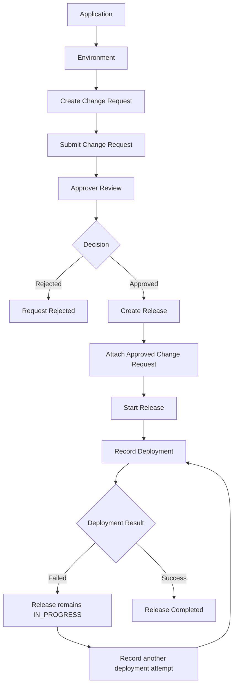
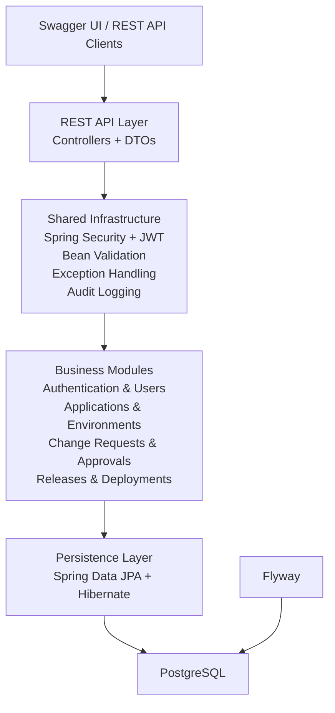

# Release Management Platform

A backend-focused release management platform built with Java and Spring Boot to manage software changes from request submission and approval through release tracking, deployment recording, and audit history.

The project is implemented as a **modular monolith** with a REST API, PostgreSQL persistence, JWT-based authentication, role-based authorization, database migrations, and automated tests.

## Overview

The platform provides a controlled workflow for managing application changes and releases:

- Manage applications and deployment environments
- Create and submit change requests
- Review and approve or reject changes
- Prevent self-approval of change requests
- Create releases and associate approved changes
- Start releases and record deployment attempts
- Preserve failed deployment attempts for retry
- Complete releases after a successful deployment
- Maintain an audit history of important actions
- Secure API access using JWT authentication and role-based authorization

The platform **records deployment outcomes rather than performing remote deployments**. It focuses on release governance and tracking rather than replacing a CI/CD system.

## Workflow



A failed deployment does not complete the release. The release remains `IN_PROGRESS` so another deployment attempt can be recorded.

## Architecture



The application uses a modular monolith structure. Business functionality is separated into domain modules, while security, validation, exception handling, and audit logging provide shared infrastructure.

## Database Design

```mermaid
erDiagram
    USERS {
        BIGINT id PK
        VARCHAR name
        VARCHAR email UK
        VARCHAR password_hash
        VARCHAR role
        BOOLEAN active
        TIMESTAMPTZ created_at
        TIMESTAMPTZ updated_at
    }

    APPLICATIONS {
        BIGINT id PK
        VARCHAR name UK
        TEXT description
        BOOLEAN active
        TIMESTAMPTZ created_at
        TIMESTAMPTZ updated_at
    }

    ENVIRONMENTS {
        BIGINT id PK
        BIGINT application_id FK
        VARCHAR name
        VARCHAR environment_type
        BOOLEAN active
        TIMESTAMPTZ created_at
    }

    RELEASES {
        BIGINT id PK
        BIGINT environment_id FK
        VARCHAR version
        TEXT description
        VARCHAR status
        TIMESTAMPTZ scheduled_at
        BIGINT created_by FK
        TIMESTAMPTZ created_at
        TIMESTAMPTZ updated_at
    }

    CHANGE_REQUESTS {
        BIGINT id PK
        BIGINT environment_id FK
        BIGINT release_id FK
        VARCHAR title
        TEXT description
        VARCHAR change_type
        VARCHAR status
        BIGINT requested_by FK
        TIMESTAMPTZ planned_at
        TIMESTAMPTZ created_at
        TIMESTAMPTZ updated_at
    }

    APPROVALS {
        BIGINT id PK
        BIGINT change_request_id FK UK
        BIGINT approver_id FK
        VARCHAR decision
        TEXT comments
        TIMESTAMPTZ decided_at
    }

    DEPLOYMENTS {
        BIGINT id PK
        BIGINT release_id FK
        INTEGER attempt_number
        VARCHAR status
        BIGINT deployed_by FK
        TIMESTAMPTZ started_at
        TIMESTAMPTZ completed_at
        TEXT notes
    }

    AUDIT_LOGS {
        BIGINT id PK
        BIGINT user_id FK
        VARCHAR entity_type
        BIGINT entity_id
        VARCHAR action
        JSONB details
        TIMESTAMPTZ created_at
    }

    APPLICATIONS ||--o{ ENVIRONMENTS : contains
    ENVIRONMENTS ||--o{ RELEASES : has
    ENVIRONMENTS ||--o{ CHANGE_REQUESTS : receives

    USERS ||--o{ RELEASES : creates
    USERS ||--o{ CHANGE_REQUESTS : requests
    USERS ||--o{ APPROVALS : approves
    USERS ||--o{ DEPLOYMENTS : records
    USERS ||--o{ AUDIT_LOGS : generates

    RELEASES ||--o{ CHANGE_REQUESTS : includes
    CHANGE_REQUESTS ||--o| APPROVALS : receives
    RELEASES ||--o{ DEPLOYMENTS : tracks
```

The database separates releases from deployment attempts so failed attempts remain part of the release history and subsequent retries can be recorded.

## Technology Stack

| Area | Technology |
|---|---|
| Language | Java 21 |
| Framework | Spring Boot 4.1.2 |
| API | Spring MVC / REST |
| Persistence | Spring Data JPA + Hibernate |
| Database | PostgreSQL |
| Database migrations | Flyway |
| Security | Spring Security + JWT |
| Validation | Jakarta Bean Validation |
| API documentation | OpenAPI / Swagger UI |
| Testing | JUnit 5, Mockito, Spring Boot Test |
| Build | Maven |

## Project Structure

```text
src/
├── main/
│   ├── java/com/ravikanth/releasemanagement/
│   │   ├── auth/
│   │   ├── user/
│   │   ├── application/
│   │   ├── environment/
│   │   ├── changerequest/
│   │   ├── approval/
│   │   ├── release/
│   │   ├── deployment/
│   │   └── common/
│   │       ├── audit/
│   │       ├── config/
│   │       ├── exception/
│   │       └── security/
│   │
│   └── resources/
│       ├── application.properties
│       └── db/migration/
│
└── test/
    ├── java/
    └── resources/
```

The package structure follows business domains rather than grouping every controller, service, and repository into global technical folders.

## API

The REST API is documented with OpenAPI and Swagger UI.

Main API areas include:

- Authentication
- Users
- Applications
- Environments
- Change Requests
- Approvals
- Releases
- Deployments
- Audit Logs

Swagger UI provides an interactive way to explore and test the API.

## Security

The application uses stateless JWT authentication with Spring Security.

Security controls include:

- JWT bearer authentication
- Role-based authorization
- Method-level security
- Stateless sessions
- Protected API endpoints by default
- Dedicated authentication and access-denied responses
- Password hashing
- Validation of authenticated users
- Authorization checks around approval and release operations

## Audit Logging

Important business actions are recorded in an audit log containing:

- User
- Entity type
- Entity ID
- Action
- Structured JSON details
- Timestamp

Audit logging is implemented as shared infrastructure so different business modules can record important actions consistently.

## Database Migrations

Flyway manages database schema evolution.

Current migrations:

```text
V1__initial_schema.sql
V2__application_name_case_insensitive_unique.sql
```

Hibernate is configured with schema validation rather than automatic schema creation or modification.

## Configuration

Database credentials and the JWT signing secret are supplied through environment variables.

Required configuration includes:

```text
DB_PASSWORD
JWT_SECRET
```

The application connects to PostgreSQL and uses Flyway to validate and apply database migrations during startup.

## Running Locally

### Prerequisites

- Java 21
- Maven
- PostgreSQL
- Git

### Configure the database

Create a PostgreSQL database named:

```text
release_management
```

Configure the required environment variables before starting the application.

### Start the application

From the project root:

```powershell
.\mvnw.cmd spring-boot:run
```

The API runs on:

```text
http://localhost:8080
```

Swagger UI is available from the running application.

## Testing

The project includes unit, controller, security, and integration-oriented tests.

Run the complete test suite with:

```powershell
.\mvnw.cmd test
```

The test configuration uses PostgreSQL for tests that require database integration.

## Design Decisions

### Modular monolith

The application uses a modular monolith instead of microservices. This keeps deployment and development straightforward while maintaining clear boundaries between business domains.

### Release tracking instead of remote deployment

The platform records deployment attempts and outcomes but does not execute deployments against external infrastructure. This keeps the project focused on release governance rather than becoming a CI/CD engine.

### Deployment attempts

Deployments are modeled separately from releases so failed attempts are preserved and subsequent retries can be recorded.

### Database-first schema management

Flyway owns schema evolution while Hibernate validates the resulting schema.

### Shared audit infrastructure

Audit logging is centralized so important actions across different business modules are recorded consistently.

## Scope

The platform focuses on:

- Change management
- Approval workflows
- Release coordination
- Deployment outcome tracking
- Auditability
- Authentication and authorization

It intentionally does not attempt to provide:

- Remote deployment execution
- A CI/CD engine
- Kubernetes orchestration
- Microservice infrastructure
- Complex workflow designers
- Analytics platforms
- AI-based release decisions

## Project Status

The core backend workflow is implemented and tested.

Current implementation includes:

- Authentication and authorization
- Application and environment management
- Change request lifecycle
- Approval workflow
- Release management
- Deployment attempt tracking
- Audit logging
- OpenAPI / Swagger documentation
- Automated tests

Remaining work is focused on final project verification and delivery preparation, including containerization and CI validation.